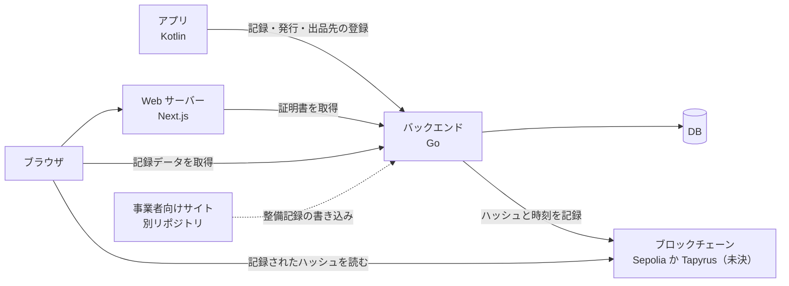

# 構成

Webは読み取り専用のNext.jsアプリで、Goバックエンド（smapass-back）から端末の状態と記録を取り、ブラウザで検証する。ブロックチェーンとの照合は、Back がチェーンに記録するようになってから足す。書き込みはすべてアプリ経由。

## 全体構成

| 担当 | 役割 |
| --- | --- |
| アプリ（Kotlin） | 端末情報の取得と定期記録、証明書の発行、出品先の登録 |
| バックエンド（Go） | 記録の保存、評価の算出、ブロックチェーンへのハッシュ記録（未実装）、Web向けAPI |
| Web（Next.js、このリポジトリ） | 証明書の表示（整備記録を含む）、ブラウザ検証、カード画像・OGP画像の生成 |
| 事業者向けサイト（別リポジトリ） | メーカー・修理業者のログインと、整備記録の書き込み（[decisions/0009](decisions/0009-partner-site-separate-repo.md)） |

ブラウザ検証では、記録データはGoから、ハッシュはブロックチェーンから別々に取る。運営者のサーバーだけを信じなくて済むようにするため（[decisions/0001](decisions/0001-verify-in-browser.md)）。

## 技術選定と代案

| 項目 | 採用案 | 代案 | 理由 |
| --- | --- | --- | --- |
| フレームワーク | Next.js（App Router） | Pages Router | サーバー側描画と画像生成が標準で揃う |
| 言語 | TypeScript | ― | APIの型をそろえやすい |
| カード画像・OGP画像 | Next.jsの画像生成（`ImageResponse`） | アプリで生成 | 1か所でレイアウトを管理し、OGPと共用できる（[decisions/0007](decisions/0007-card-image-on-web.md)） |
| QRコード生成 | npmのQR生成ライブラリ | 外部のQR生成サービス | 外部サービスに証明書URLを渡さずに済む |
| ハッシュ計算 | Web Crypto API（SHA-256） | 外部ライブラリ | ブラウザ標準で追加の依存がない |
| JSON正規化 | RFC 8785（JCS）の実装ライブラリ | 独自のキー順ソート | Kotlin・Goでも同じ仕様に合わせられる（[features/verification.md](features/verification.md)） |
| チェーンの読み取り | viem | ethers.js | TypeScriptの型付けが手厚い |
| RPCプロバイダ | 無料枠のあるRPCサービスを1つ | 公開RPC | 公開RPCは不安定なことがある。どれにするかは要決定 |
| グラフ | Recharts | Chart.js | Reactのコンポーネントとして書ける |
| ホスティング | Vercel | VPS（Docker＋nginx） | Next.jsの機能をそのまま使える。運用方針が決まったら `ops/` に書く |

## ルート

画面のパスは [screens.md](screens.md)。画面以外のルートは次の通り。

| パス | 中身 |
| --- | --- |
| `/certificates/[ID]/card.png` | 出品用カード画像（[features/qr.md](features/qr.md)） |
| `/certificates/[ID]` のOGP画像 | カード画像と同じ仕組みで生成する |

## Webが使うAPI

smapass-back の公開 API（認証なし・読み取り専用）。定義は smapass-back の docs/api.md・docs/openapi.json。

| メソッド | パス | 呼ぶ場所 | 用途 |
| --- | --- | --- | --- |
| GET | `/api/devices/{id}?limit=&offset=` | Web のサーバー | 概要・詳細・出品用素材・カード画像・OGP画像。最新のスペック・状態と全期間の履歴（history を total まで順に取得） |
| GET | `/api/devices/{id}/records?limit=&offset=` | ブラウザ | ブラウザ検証。全ログの canonical_payload・ハッシュ・署名・チェーン情報 |
| GET | `/api/devices/search?imeis=` | ブラウザ | 届いた端末との照合（FR-05）。IMEI を Web のサーバーに通さないため、ブラウザから直接呼ぶ |

- Back の URL は環境変数 `NEXT_PUBLIC_BACKEND_ORIGIN`（開発時は `http://localhost:8080`）で受け取る
- ブラウザから直接呼ぶので、Back の `CORS_ORIGINS` に Web の Origin を完全一致（scheme・host・port、末尾の / なし）で入れる。Cookie は使わない
- Web の正規のドメイン（QR・カード画像・コピー用URLに載せる）は環境変数 `SITE_ORIGIN` で受け取り、`CORS_ORIGINS` に入れる値と同じにする。リクエストの Host ヘッダーからは決めない。本番では必須で https に限り、未設定・不正なら起動時にエラーにする
- `limit` は1〜500（Web は500で取る）、`offset` は0〜1,000,000
- エラーは `{"error":{"code","message"}}`。400・404 は not-found（「見つからないか、非公開」）、429・5xx・通信エラーは「一時的に取得できません」「照合できず」にし、「不一致」とは表示しない。Web 側のタイムアウトは8秒（Back の処理上限は5秒）
- `/api/devices?ids=`（一括の概要）はブックマーク・比較用だが、Web はブックマークをなくしたので使わない（[decisions/0012](decisions/0012-remove-bookmark-and-sidebar.md)）
- カード画像とOGP画像はNext.js側で生成するので、Goに専用のAPIは求めない
- 書き込み API（`/api/auth/*`、logs、visibility、revoke など）は Android アプリ専用で、Web は使わない
