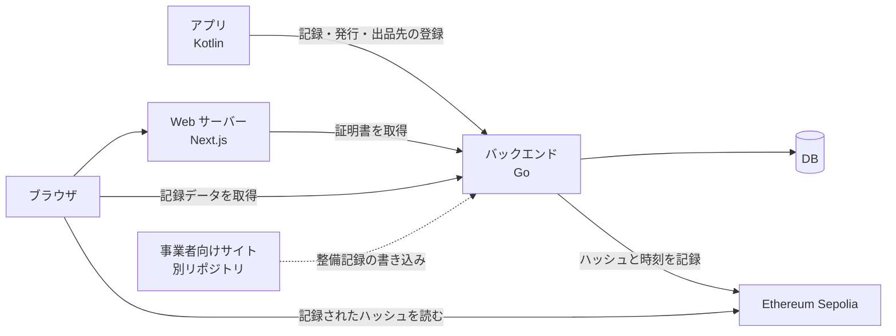

# 構成

Webは読み取り専用のNext.jsアプリで、Goバックエンドから証明書を取り、ブラウザからSepoliaを直接読んで検証する。書き込みはすべてアプリ経由。

## 全体構成

| 担当 | 役割 |
| --- | --- |
| アプリ（Kotlin） | 端末情報の取得と定期記録、証明書の発行、出品先の登録 |
| バックエンド（Go） | 記録の保存、評価の算出、Sepoliaへのハッシュ記録、Web向けAPI |
| Web（Next.js、このリポジトリ） | 証明書の表示（整備記録を含む）、ブラウザ検証、カード画像・OGP画像の生成、ブックマーク |
| 事業者向けサイト（別リポジトリ） | メーカー・修理業者のログインと、整備記録の書き込み（[decisions/0009](decisions/0009-partner-site-separate-repo.md)） |

ブラウザ検証では、記録データはGoから、ハッシュはSepoliaから別々に取る。運営者のサーバーだけを信じなくて済むようにするため（[decisions/0001](decisions/0001-verify-in-browser.md)）。

## 技術選定と代案

| 項目 | 採用案 | 代案 | 理由 |
| --- | --- | --- | --- |
| フレームワーク | Next.js（App Router） | Pages Router | サーバー側描画と画像生成が標準で揃う |
| 言語 | TypeScript | ― | APIの型をそろえやすい |
| カード画像・OGP画像 | Next.jsの画像生成（`ImageResponse`） | アプリで生成 | 1か所でレイアウトを管理し、OGPと共用できる（[decisions/0007](decisions/0007-card-image-on-web.md)） |
| QRコード生成 | npmのQR生成ライブラリ | 外部のQR生成サービス | 外部サービスに証明書URLを渡さずに済む |
| ハッシュ計算 | Web Crypto API（SHA-256） | 外部ライブラリ | ブラウザ標準で追加の依存がない |
| JSON正規化 | RFC 8785（JCS）の実装ライブラリ | 独自のキー順ソート | Kotlin・Goでも同じ仕様に合わせられる（[features/verification.md](features/verification.md)） |
| チェーンの読み取り | viem | ethers.js | TypeScriptの型付けが手厚い |
| RPCプロバイダ | 無料枠のあるRPCサービスを1つ | 公開RPC | 公開RPCは不安定なことがある。どれにするかは要決定 |
| グラフ | Recharts | Chart.js | Reactのコンポーネントとして書ける |
| ブックマークの保存 | localStorage | IndexedDB | 件数が少なく、単純なキー・値で足りる（[decisions/0002](decisions/0002-bookmark-in-browser.md)） |
| ホスティング | Vercel | VPS（Docker＋nginx） | Next.jsの機能をそのまま使える。運用方針が決まったら `ops/` に書く |

## ルート

画面のパスは [screens.md](screens.md)。画面以外のルートは次の通り。

| パス | 中身 |
| --- | --- |
| `/c/[番号]/card.png` | 出品用カード画像（[features/qr.md](features/qr.md)） |
| `/c/[番号]` のOGP画像 | カード画像と同じ仕組みで生成する |

## Webが使うAPI（案）

| メソッド | パス | 用途 | 返すもの |
| --- | --- | --- | --- |
| GET | `/api/certificates/{番号}` | 証明書詳細・カード画像・OGP画像 | 端末情報、評価と説明文、推移グラフ用データ、出品先、有効・失効の状態 |
| GET | `/api/certificates/{番号}/records` | ブラウザ検証 | 正規化済みの記録データ本体、各ハッシュ、トランザクションハッシュ |
| GET | `/api/certificates?ids=a,b,c` | ブックマーク一覧 | 複数証明書の要約 |
| GET / POST / DELETE | `/api/me/bookmarks` | ブックマーク（[decisions/0002](decisions/0002-bookmark-in-browser.md) の案Bのみ） | ログインユーザーのブックマーク |

- カード画像とOGP画像はNext.js側で生成するので、Goに専用のAPIは求めない
- 出品先を登録するAPIはアプリとGoの間で決める。Webは使わない
- ブラウザがGoのAPIを直接呼ぶ場合はCORSの許可が必要。代案はNext.jsのRoute Handlerを経由させる形
- MVPのWebは読み取り専用で、案Bを採らない限り書き込み系のAPIは使わない
