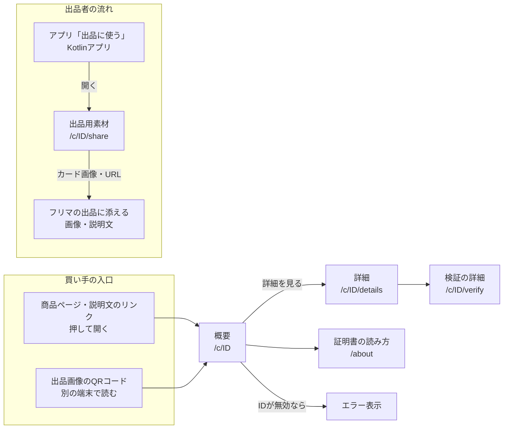

# 画面

MVPは7画面。買い手は出品のリンクやQRから概要画面に、出品者はアプリから出品用素材ページに着地する。MVPではログイン不要。

## 画面一覧

| 画面 | パス | 内容 | 主な利用者 | 関連要件 |
| --- | --- | --- | --- | --- |
| 概要 | `/c/[ID]` | 総合評価、検証結果、出品との照合、項目別の評価、「詳細を見る」ボタン | 買い手 | FR-01、FR-02、FR-04、FR-05、FR-07、FR-08、FR-19 |
| 詳細 | `/c/[ID]/details` | 評価サマリー、検証結果、出品先、端末情報、推移グラフ、記録タイムライン | 買い手 | FR-01〜FR-03、FR-05〜FR-08、FR-18 |
| 出品用素材 | `/c/[ID]/share` | カード画像の保存、URLと説明文用テキストのコピー、出品先の登録状況 | 出品者 | FR-11、FR-12 |
| 検証の詳細 | `/c/[ID]/verify` | 記録ごとのハッシュ・トランザクション・照合結果、Etherscanへのリンク | 買い手 | FR-09、FR-10 |
| トップ | `/` | サービス説明と、証明書の開き方の案内 | 両方 | ― |
| 証明書の読み方 | `/about` | 評価の見方と、ブロックチェーンで保証できること・できないこと | 両方 | FR-04 |
| エラー | `/c/[ID]` 内で表示 | 存在しない・失効済み・再発行済みの案内 | 買い手 | FR-07 |

出品用素材ページは誰でも開けるが、出品先の登録はアプリ側で行う。

メニューやサイドバーは置かず、画面の移動は各画面のボタンとリンクで行う（[decisions/0012](decisions/0012-remove-bookmark-and-sidebar.md)）。

## 画面遷移

## 概要

QRコードやURLで最初に開く画面（FR-19）。スマホに詳しくない人でも、最初の1画面で評価と「この出品の端末か」を判断できるようにする。専門用語を避け、グラフや記録の表は出さない。

| 順 | 区分 | 項目 | 表示の仕方 |
| --- | --- | --- | --- |
| 1 | 警告 | 失効・再発行済みの警告 | 該当するときだけ内容より上に出す |
| 2 | 結論 | 機種名、総合評価、評価の一言、記録期間・回数・発行日、途切れた期間、検証結果 | 大きめの文字で出す。検証結果は一致・不一致・照合できずを区別し、件数は出さない |
| 3 | 出品との照合 | 出品先（フリマ名・商品ID）、IMEIの末尾4桁 | 開いている出品と同じか確かめるよう案内する。IMEIの確かめ方（*#06#）も添える |
| 4 | 評価の内訳 | 項目別（バッテリー・発熱・安定性）の評価と説明文 | バックエンドが返す説明文をそのまま出す。説明文は専門用語を避けて書いてもらう |
| 5 | 次の行動 | 「詳細を見る」ボタン、証明書の読み方へのリンク | 目立つボタンで詳細画面へ。証明できる範囲の注意を1行添え、一番下に「証明書の読み方はこちら」を置く（FR-04） |

## 詳細

「詳細を見る」で開く、すべての情報を載せた画面。上から「結論→出品との照合→根拠→詳細」の順に並べる。

| 順 | 区分 | 項目 | 表示の仕方 |
| --- | --- | --- | --- |
| 1 | 結論 | 機種名、総合評価、評価の根拠になった記録期間・記録回数・発行日、検証結果（一致・不一致・照合できず） | バッジ＋一言の説明。記録期間・回数・発行日は評価の下に1行で添え、記録期間が短い場合は注意書きを出す。検証結果は一致ならバッジだけにし、記録数と照合日時は検証の詳細画面で見せる。不一致・照合できずは理由と次の行動（詳細を見る・再試行）まで出す。有効・失効の状態は、失効・再発行済みのときだけ内容より上に警告で出す。色だけで良し悪しを表さない |
| 2 | 出品との照合 | 出品先（フリマ名・商品ID）、IMEIの末尾4桁 | 「開いている出品と一致するか確かめてください」と添える。IMEIの確かめ方（*#06#）も案内する |
| 3 | 端末情報 | メーカー、モデル、端末名、SoC、CPUコア数、RAM、ストレージ、画面サイズ・密度、Android（最新の記録の値） | 仕様表。取得日を添える |
| 4 | バッテリー | 推定最大電荷、記録開始時からの変化（%）、サイクルカウント | 数値＋推定最大電荷の推移グラフ |
| 5 | 発熱 | 最高温度、45℃を超えた回数、熱的余裕の最大値 | 数値＋温度と熱的余裕の推移グラフ（目安の線つき） |
| 6 | 安定性 | 累計起動回数、異常終了があった記録 | 数値＋異常終了の日付一覧＋1週間あたりの起動回数の棒グラフ |
| 7 | OSの更新履歴 | Android OSバージョン・SDKが変わった記録 | 表 |
| 8 | 評価の根拠 | 項目別（バッテリー・発熱・安定性）の評価と説明文 | 「なぜこの評価か」を項目ごとに1〜2文で |
| 9 | 記録の一覧 | 途切れた期間、全記録の値（充放電サイクル回数・残り電荷を含む） | 途切れた期間は常に表示し、全記録の表は折りたたみ |
| 10 | 整備記録 | 事業者による修理・点検の記録。記録者（事業者名と種別）・日時・内容 | アプリの自動記録と見た目で区別する（FR-18）。書き込みは別リポジトリの事業者向けサイト |
| 11 | 注意事項 | 証明できること・できないこと、テストネット（Sepolia）利用の明記 | 固定文。/about へのリンク |

注意事項の中身は [security.md](security.md) の信頼モデルに合わせる。

## 出品用素材

カード画像のプレビューと保存ボタン、URLのコピー、説明文用テキストのコピー、出品先の登録状況を1画面に並べる。中身と仕様は [features/qr.md](features/qr.md)。

## 検証の詳細

記録ごとに、記録時刻・ハッシュ・トランザクションハッシュ・照合結果を並べる。Etherscan（Sepolia）へのリンクと、正規化済みJSONのダウンロード（FR-10）を置く。検証の仕組みは [features/verification.md](features/verification.md)。

## トップ

サービスの説明と、証明書は出品のリンクやQRから開くことを案内する。証明書番号はないので、入力欄は置かない（[decisions/0010](decisions/0010-url-and-qr-only.md)）。

## エラー表示

| 状態 | 表示 |
| --- | --- |
| 存在しないID | URLが途中で切れていないかの確認と、出品ページのリンクから開き直す案内 |
| 失効済み | 失効した旨と失効日時。内容は表示するが警告を上に出す |
| 再発行済み | 新しい証明書へのリンク |
| 通信エラー | 再読み込みの案内。検証の「照合できず」とは別の表示 |
