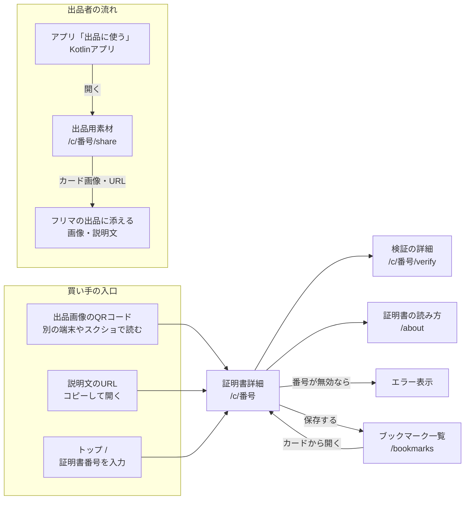

# 画面

MVPは7画面。買い手は出品のQR・URL・番号から証明書詳細に、出品者はアプリから出品用素材ページに着地する。MVPではログイン不要。

## 画面一覧

| 画面 | パス | 内容 | 主な利用者 | 関連要件 |
| --- | --- | --- | --- | --- |
| 証明書詳細 | `/c/[番号]` | 評価サマリー、検証結果、出品先、端末情報、推移グラフ、記録タイムライン | 買い手 | FR-01〜FR-08、FR-13、FR-18 |
| 出品用素材 | `/c/[番号]/share` | カード画像の保存、URLと説明文用テキストのコピー、出品先の登録状況 | 出品者 | FR-11、FR-12 |
| 検証の詳細 | `/c/[番号]/verify` | 記録ごとのハッシュ・トランザクション・照合結果、Etherscanへのリンク | 買い手 | FR-09、FR-10 |
| ブックマーク一覧 | `/bookmarks` | 保存した証明書をカードで並べて比較 | 買い手 | FR-14、FR-15 |
| トップ | `/` | 証明書番号の入力欄（主役）とサービス説明 | 買い手 | FR-16 |
| 証明書の読み方 | `/about` | 評価の見方と、ブロックチェーンで保証できること・できないこと | 両方 | FR-04 |
| エラー | `/c/[番号]` 内で表示 | 存在しない・失効済み・再発行済み・番号の打ち間違いの案内 | 買い手 | FR-07、FR-16 |

出品用素材ページは誰でも開けるが、出品先の登録はアプリ側で行う。[decisions/0002](decisions/0002-bookmark-in-browser.md) で案B（アカウント）を採る場合はログイン画面が1つ増える。

## 画面遷移

## 証明書詳細

上から「結論→出品との照合→根拠→詳細」の順に並べる。QRから来た買い手が最初の1画面で、評価と「この出品の端末か」を判断できるようにする。

| 順 | 区分 | 項目 | 表示の仕方 |
| --- | --- | --- | --- |
| 1 | 結論 | 機種名、総合評価、検証結果（一致・不一致・照合できず） | バッジ＋一言の説明。色だけで良し悪しを表さない |
| 2 | 出品との照合 | 出品先（フリマ名・商品ID）、製造番号の末尾 | 「開いている出品と一致するか確かめてください」と添える。製造番号は出品者申告と明記 |
| 3 | 証明書情報 | 証明書番号、発行日時、記録期間、記録回数、有効・失効 | テキスト。記録期間が短い場合は注意書きを出す |
| 4 | 端末情報 | メーカー、モデル、SoC、Androidバージョン | テキスト |
| 5 | バッテリー | 充放電サイクル回数、残容量 | 現在値＋推移グラフ |
| 6 | 熱・負荷 | 温度履歴、消費電力 | 推移グラフ。高温の目安を超えた回数も表示 |
| 7 | 使用状況 | 稼働時間 | 数値 |
| 8 | 評価の根拠 | 項目別の評価と説明文 | 「なぜこの評価か」を項目ごとに1〜2文で |
| 9 | 記録タイムライン | 記録日時の一覧、途切れた期間 | 折りたたみ表示 |
| 10 | 整備記録 | 事業者による修理・点検の記録。記録者（事業者名と種別）・日時・内容 | アプリの自動記録と見た目で区別する（FR-18）。書き込みは別リポジトリの事業者向けサイト |
| 11 | 注意事項 | 証明できること・できないこと、テストネット（Sepolia）利用の明記 | 固定文。/about へのリンク |

注意事項の中身は [security.md](security.md) の信頼モデルに合わせる。ブックマークの追加・削除ボタンは結論の近くに置く。

## 出品用素材

カード画像のプレビューと保存ボタン、URLのコピー、説明文用テキストのコピー、出品先の登録状況を1画面に並べる。中身と仕様は [features/qr.md](features/qr.md)。

## 検証の詳細

記録ごとに、記録時刻・ハッシュ・トランザクションハッシュ・照合結果を並べる。Etherscan（Sepolia）へのリンクと、正規化済みJSONのダウンロード（FR-10）を置く。検証の仕組みは [features/verification.md](features/verification.md)。

## ブックマーク一覧

カード1枚に機種名・総合評価・残容量・出品先・メモを出す。評価順・発行日順で並べ替えられる。失効した証明書はカードに失効と表示する。

## トップ

最初の画面に証明書番号の入力欄を置く。出品画像のQRは、それを見ているスマホのカメラでは読めないため、番号入力が主な入口になる。入力のルールは [features/qr.md](features/qr.md)。

## エラー表示

| 状態 | 表示 |
| --- | --- |
| 存在しない番号 | 打ち間違いの可能性と、番号の入力欄 |
| 失効済み | 失効した旨と失効日時。内容は表示するが警告を上に出す |
| 再発行済み | 新しい証明書へのリンク |
| 通信エラー | 再読み込みの案内。検証の「照合できず」とは別の表示 |
