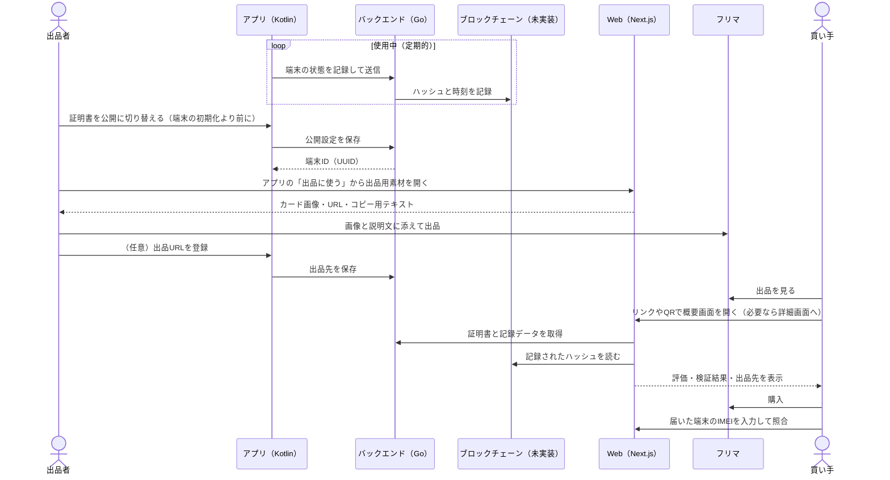

# 業務の流れ

Webの出番は「出品用素材」と「証明書」の2か所。出品者はアプリで公開に切り替えてWebで素材を受け取り、買い手はフリマの出品からWebの証明書の概要画面に来て、必要なら詳細画面に進む。

## 出品から購入・受け取りまで

## 各段階のポイント

1. 記録：アプリが定期的に端末の状態を記録して署名し、Back に送る。Back はハッシュをブロックチェーンに刻む予定（未実装）。Webは関与しない。証明書のページは新しい記録が届くたびに更新される（[decisions/0014](decisions/0014-show-latest-device-state.md)）
2. 公開：初回登録時は非公開なので、出品前にアプリから公開に切り替える。スマホは工場出荷状態に初期化して出品するのが前提なので、初期化より前に済ませる。アプリ側で案内する
3. 出品用素材の取得：アプリの「出品に使う」ボタンで `/certificates/[ID]/share` を開き、カード画像を保存してテキストをコピーする（[features/qr.md](features/qr.md)）
4. 出品：カード画像を出品画像の1枚に、URLを説明文に添える。フリマの規約上の扱いは [decisions/0004](decisions/0004-marketplace-policy.md)
5. 出品先の登録（任意）：出品後、アプリから出品URLを登録する。IMEIはアプリが端末情報として取得する（[decisions/0011](decisions/0011-device-data-items.md)）。他人の証明書の流用対策になる（[decisions/0006](decisions/0006-listing-link.md)）
6. 閲覧と検証：買い手は商品ページや説明文のリンクを押すか、別の端末でQRを読んで開く。検証はページ表示後にブラウザで走る（[features/verification.md](features/verification.md)）
7. 受け取り後の照合：届いた端末のIMEI（`*#06#`）を証明書のページに入力し、この証明書の端末か確かめる（[decisions/0015](decisions/0015-imei-input-check.md)）

## 例外の流れ

| 場面 | Webの振る舞い |
| --- | --- |
| URLが途中で切れている・非公開になっている | 「この証明書は見つからないか、非公開に設定されています」と表示し、出品ページのリンクから開き直すよう案内する（HTTP 404） |
| 端末の API が落ちている・混んでいる（429・5xx） | 「一時的に表示できません」と表示し、再読み込みを案内する。「見つからない」「不一致」とは表示しない |
| 記録の API やRPCが落ちている | 証明書を表示し、検証欄を「照合できず（再試行）」にする |
| 検証が「不一致」 | どの記録が一致しなかったかを示し、/about の説明へ誘導する |
| 他人の証明書が流用されている | 受け取り後に IMEI の照合で「別の端末の証明書です」と分かる。出品前に見分ける出品先の表示は Back の実装待ち |
