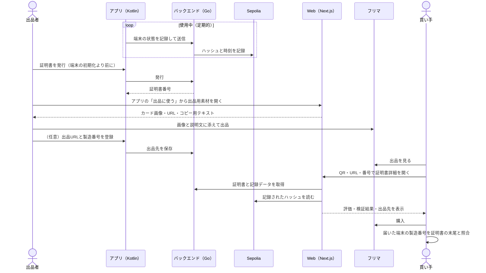

# 業務の流れ

Webの出番は「出品用素材」と「証明書詳細」の2か所。出品者はアプリで発行してWebで素材を受け取り、買い手はフリマの出品からWebの証明書詳細に来る。

## 出品から購入・受け取りまで

## 各段階のポイント

1. 記録：アプリが定期的に端末の状態を記録し、ハッシュと時刻をSepoliaに刻む。Webは関与しない
2. 発行：スマホは工場出荷状態に初期化して出品するのが前提なので、初期化より前に発行を済ませる。アプリ側で案内する
3. 出品用素材の取得：アプリの「出品に使う」ボタンで `/c/[番号]/share` を開き、カード画像を保存してテキストをコピーする（[features/qr.md](features/qr.md)）
4. 出品：カード画像を出品画像の1枚に、番号とURLを説明文に添える。フリマの規約上の扱いは [decisions/0004](decisions/0004-marketplace-policy.md)
5. 出品先の登録（任意）：出品後、アプリから出品URLと製造番号を登録する。他人の証明書の流用対策になる（[decisions/0006](decisions/0006-listing-link.md)）
6. 閲覧と検証：買い手は別の端末やスクショでQRを読むか、URLや番号で開く。検証はページ表示後にブラウザで走る（[features/verification.md](features/verification.md)）
7. 受け取り後の照合：届いた端末の製造番号を、証明書に出ている末尾と比べる

## 例外の流れ

| 場面 | Webの振る舞い |
| --- | --- |
| 番号を打ち間違えた | 0とO、1とIなどは自動で吸収する。それでも見つからなければ「打ち間違いの可能性」を案内する |
| 証明書が失効・再発行済み | 内容の上に警告を出し、再発行なら新しい証明書へのリンクを出す |
| APIやRPCが落ちている | 取得できた範囲で証明書を表示し、検証欄を「照合できず（再試行）」にする |
| 検証が「不一致」 | どの記録が一致しなかったかを示し、/about の説明へ誘導する |
| 他人の証明書が流用されている | Webには買い手がどの出品から来たか分からないので、出品先を最初の画面に出し、買い手に開いている出品と比べてもらう |
